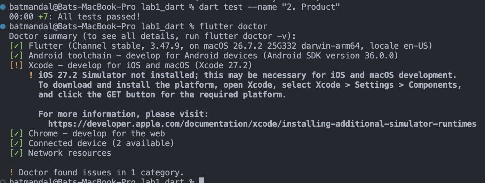
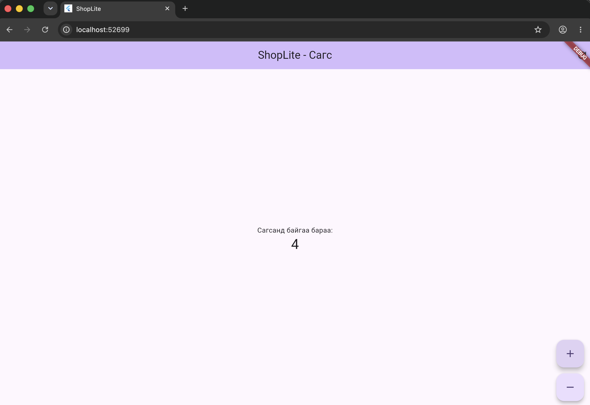

# ShopLite — Мобайл апп хөгжүүлэлт (Flutter)

**Нэр:** …  
**Оюутны код:** 22B1NUM0632

Энэ репозиторид 6 долоо хоногийн турш бүх лабораторийн кодоо хадгална.

```
├── README.md          ← энэ файл (доорх хэсгүүдийг бөглөнө)
├── screenshots/       ← дэлгэцийн зураг
├── lab1_dart/         ← Лаборатори 1: Dart дасгал
└── shoplite/          ← Лаборатори 1-д `flutter create`-оор үүсгэнэ
```

## Код хадгалах (лаборатори бүрийн төгсгөлд)

```bash
git add .
git commit -m "Lab 1: Dart модель, shoplite апп"
git push
git tag v0.1            # Лаб 1 → v0.1, Лаб 2 → v0.2, ...
git push origin v0.1
```

Push хийсний дараа GitHub дээрх **Actions** табаас автомат тестийн үр дүнг (ногоон ✓ / улаан ✗) харна.
`lab1_dart/test/` болон `.github/` хавтасны файлуудыг **өөрчлөхгүй**.

---

## Лаборатори 1




### lab1_dart

- `dart test test/lab1_test.dart`: 25 / 25
- Бонус B1 (`dart test test/bonus_test.dart`): хийсэн

### D2. Төслийн бүтэц

1. `lib/main.dart`-д ямар классууд байна? Аль нь StatelessWidget, аль нь StatefulWidget вэ?
   > `ShopLiteApp` (анх `MyApp`), `MyHomePage`, `_MyHomePageState` гэсэн 3 класс байна. `ShopLiteApp` нь **StatelessWidget**: `MaterialApp`-ийг (гарчиг, theme, нүүр хуудас) тохируулдаг, өөрчлөгдөх төлөвгүй. `MyHomePage` нь **StatefulWidget**: `title`-ийг хүлээн авдаг бөгөөд төлөвөө `_MyHomePageState` (`State<MyHomePage>`) классаар хадгалдаг. Тоолуурын `_counter` утга нь `_MyHomePageState`-д байдаг ба `setState()`-ээр нэмэгдэхэд дэлгэц дахин зурагдана.
2. `pubspec.yaml`-д ямар сангууд байна?
   > `dependencies`-д `flutter` (SDK) болон `cupertino_icons` (^1.0.8, iOS загварын icon-ууд) байна. `dev_dependencies`-д `flutter_test` (widget тест бичих) болон `flutter_lints` (^6.0.0, кодын зөвлөмж, lint дүрмүүд) байна.
3. `android/` хавтас юунд хэрэгтэй вэ? Та ихэвчлэн аль хавтсанд код бичих вэ?
   > `android/` хавтсанд Android платформд зориулсан native төсөл (Gradle тохиргоо, `AndroidManifest.xml`, app icon, package name, minSdk гэх мэт) байрладаг. Flutter үүнийг ашиглан APK/AAB build хийдэг. Зөвшөөрөл (permission) нэмэх, native тохиргоо өөрчлөх үед л хөндөнө. Бид кодоо ихэвчлэн **`lib/`** хавтсанд Dart хэлээр бичнэ.

### D4. Hot reload ба hot restart

| Өөрчлөлт | Hot reload (r) | Hot restart (R) |
|---|---|---|
| AppBar-ийн гарчгийг өөрчлөх | Шинэчлэгдэнэ, тоолуур хадгалагдана | Шинэчлэгдэнэ, тоолуур 0 болно |
| seed өнгийг солих | Шинэчлэгдэнэ, тоолуур хадгалагдана | Шинэчлэгдэнэ, тоолуур 0 болно |
| `int _count = 0;` → `= 5` | Өөрчлөгдөхгүй (хуучин утга хэвээр) | 5-аас эхэлнэ |
| `main()` дотор `print('start');` нэмэх | Хэвлэгдэхгүй (`main()` дахин ажиллахгүй) | `start` хэвлэгдэнэ |

**Дүгнэлт:** аль тохиолдолд тоолуурын утга (state) хадгалагдсан бэ? Яагаад?
> **Hot reload** хийхэд тоолуурын утга хадгалагдсан. Hot reload нь өөрчлөгдсөн кодыг ажиллаж буй Dart VM-д оруулаад `build()` методуудыг дахин дуудна. Харин widget tree болон `State` объектуудыг шинээр үүсгэдэггүй, тиймээс `_counter`-ийн утга алдагдахгүй. Үүнтэй адил шалтгаанаар талбарын анхны утгыг (`= 5`) өөрчлөх, эсвэл `main()`-д код нэмэх нь hot reload-оор нөлөөлөхгүй: тэдгээр нь зөвхөн апп эхлэх, эсвэл State үүсэх үед нэг удаа ажилладаг. **Hot restart** нь аппыг `main()`-ээс эхлүүлж бүх State-ийг шинээр үүсгэдэг тул тоолуур анхны утгаасаа эхэлнэ.
# mobile-22b1num0632
